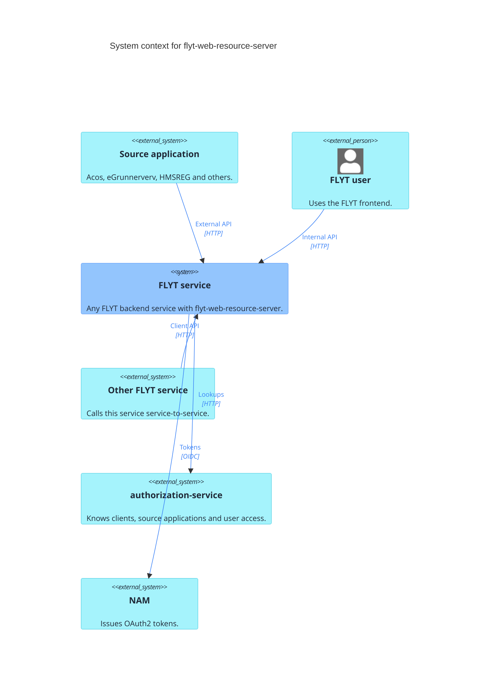
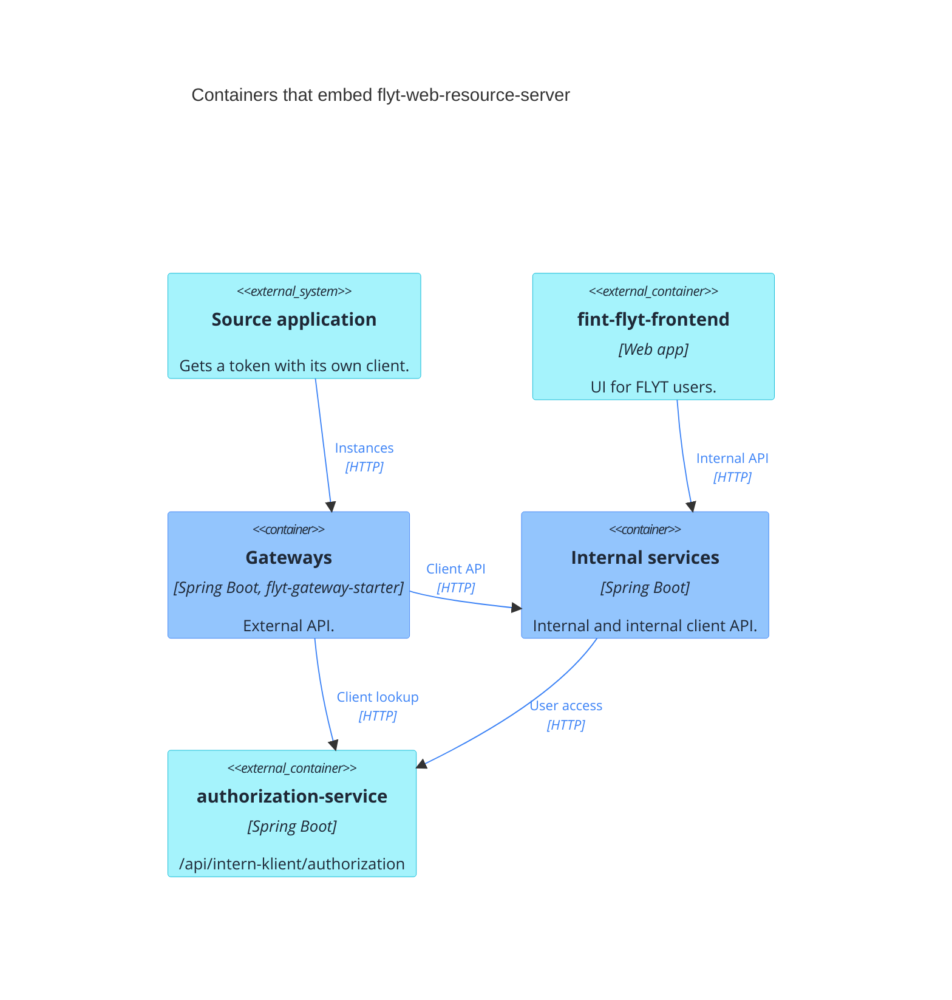
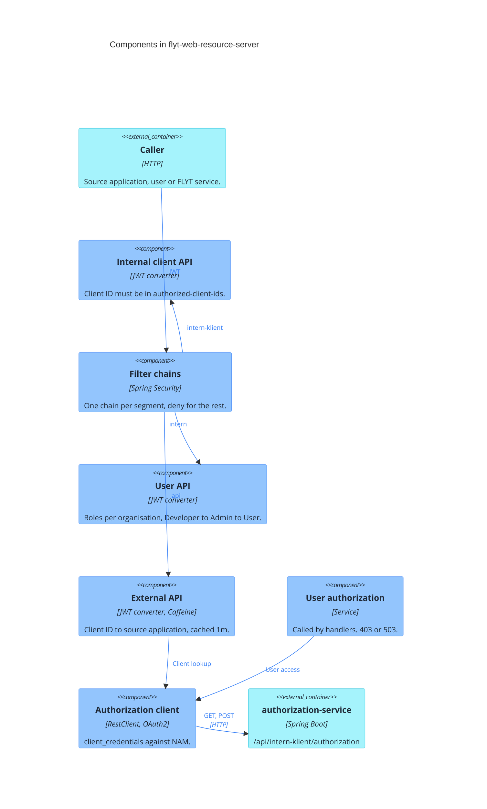

# Architecture

C4 level 1 to 3 for flyt-web-resource-server. Blue is this library or the services that embed it, turquoise is
external.

flyt-web-resource-server is a Spring Boot library, not a deployed service. Every FLYT backend service embeds it to
decide who may call which API:

| Segment                 | Callers             | Rule                                                                  |
|-------------------------|---------------------|-----------------------------------------------------------------------|
| `/api/intern/admin/**`  | FLYT users          | User token with the `ADMIN` role for the user's organisation          |
| `/api/intern/**`        | FLYT users          | User token with the `USER` role for the user's organisation           |
| `/api/intern-klient/**` | Other FLYT services | Client token whose subject is in `authorized-client-ids`              |
| `/api/**`               | Source applications | Client token whose client ID maps to an authorised source application |

Segments a service does not turn on are denied. `/actuator/**` is open.

## C4 level 1: System context

NAM issues every token. The service validates incoming tokens against the issuer and gets its own tokens with
`client_credentials` for calls to authorization-service.

## C4 level 2: Containers

| Container                                                                                   | Library via                 | Segments                  |
|---------------------------------------------------------------------------------------------|-----------------------------|---------------------------|
| acos, eapply, egrunnerverv, fskyss, hmsreg, isy-graving, side gateways and gateway-template | `flyt-gateway-starter`      | external                  |
| vigo-gateway                                                                                | `flyt-web-instance-gateway` | external                  |
| authorization-service, intgr-conf-service, archive-gateway                                  | direct                      | internal, internal-client |
| file-service                                                                                | direct                      | internal-client           |
| history, instance, discovery, integration, configuration, value-converting                  | direct                      | internal                  |
| mapping-service                                                                             | direct                      | none                      |

Calls to authorization-service use the OAuth2 registration `authorization-service` with the client
`fint-flyt-authorization-oauth2-client` (`fint.flyt.authorization.sso.*`). Base URL:
`http://fint-flyt-authorization-service:8080${server.servlet.context-path:}`. Timeouts come from
`spring.http.client.*` in the host app.

| Call                                                                                | Used for                       |
|-------------------------------------------------------------------------------------|--------------------------------|
| `GET /api/intern-klient/authorization/clients/{clientId}`                           | Every external call, cached 1m |
| `POST /api/intern-klient/authorization/users/actions/authorize-source-applications` | User access in handlers        |

## C4 level 3: Components

- External API: `404` from authorization-service is not cached and gives `401`. Other errors are not cached either,
  and the call is rejected.
- `AuthorityMappingService` encodes and parses the authorities all converters produce. It is left out of the diagram.
- Auto-configurations are listed in `META-INF/spring/org.springframework.boot.autoconfigure.AutoConfiguration.imports`.
  The external API and the authorization client need the `authorization-service` registration.
